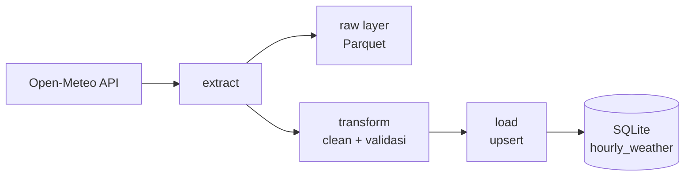

# Semarang Weather ETL


Pipeline ETL yang mengambil **prakiraan cuaca per jam untuk Semarang** dari
[Open-Meteo](https://open-meteo.com/), menyimpan data mentah, membersihkan dan
memvalidasinya, lalu memuatnya ke **SQLite** secara idempoten. Pipeline
dijadwalkan harian dengan Windows Task Scheduler.

Proyek ini dibuat sebagai latihan data engineering ujung ke ujung: extract,
raw layer, transform dengan validasi, load idempoten, logging, tes otomatis,
dan penjadwalan.

## Daftar isi

- [Alur data](#alur-data)
- [Fitur](#fitur)
- [Struktur proyek](#struktur-proyek)
- [Instalasi](#instalasi)
- [Menjalankan](#menjalankan)
- [Penjadwalan harian](#penjadwalan-harian-windows)
- [Skema database](#skema-database)
- [Keputusan desain](#keputusan-desain)
- [Contoh query](#contoh-query)
- [Pengujian](#pengujian)
- [Keterbatasan](#keterbatasan)
- [Rencana pengembangan](#rencana-pengembangan)

## Alur data



Versi teks:

```
Open-Meteo API
      |
   extract ------> raw layer (Parquet, data/raw/)
      |
  transform  (timezone, nama kolom + satuan, validasi rentang)
      |
    load ------> SQLite (data/weather.db, tabel hourly_weather)
```

Tiap tahap berupa fungsi terpisah yang menerima input dan mengembalikan hasil,
sehingga mudah diuji dan kelak mudah dipindah menjadi task di orkestrator
seperti Airflow.

## Fitur

- **Extract** dengan cache HTTP (1 jam) dan retry otomatis.
- **Raw layer**: DataFrame asli disimpan sebagai Parquet ber-timestamp, sehingga
  transform bisa dijalankan ulang tanpa memanggil API lagi.
- **Transform** dengan validasi: hujan tidak negatif, probabilitas 0-100,
  tidak ada timestamp ganda.
- **Load idempoten**: primary key `date` + upsert, menjalankan pipeline dua kali
  tidak menggandakan data.
- **Logging** ke terminal dan file berputar (`logs/pipeline.log`), error
  tercatat lengkap dengan traceback.
- **Path absolut** berbasis lokasi proyek, aman dijalankan penjadwal dari folder
  mana pun.
- **Tes otomatis** dengan pytest (transform, load, raw layer).

## Struktur proyek

```
semarang_weather_etl/
├── main.py                     # titik masuk: extract -> raw -> transform -> load
├── pytest.ini
├── requirements.txt
├── run_pipeline.example.bat    # contoh pembungkus untuk Task Scheduler
├── src/
│   └── pipeline/
│       ├── config.py           # konstanta dan path
│       ├── extract.py          # panggil Open-Meteo
│       ├── raw.py              # simpan data mentah (Parquet)
│       ├── transform.py        # bersihkan dan validasi
│       ├── load.py             # upsert ke SQLite
│       └── logging_config.py   # logging ke terminal + file
├── tests/
│   ├── conftest.py             # fixture bersama
│   ├── test_transform.py
│   ├── test_load.py
│   └── test_raw.py
├── data/                       # dibuat otomatis, tidak masuk Git
│   ├── raw/                    # file Parquet mentah
│   ├── cache/                  # cache HTTP
│   └── weather.db              # database SQLite
└── logs/                       # dibuat otomatis, tidak masuk Git
```

## Instalasi

Prasyarat: Python 3.10 atau lebih baru dan Git.

```bash
git clone https://github.com/taufikibraahim/semarang-weather-etl
cd semarang_weather_etl

python -m venv .venv
.venv\Scripts\activate          # Windows (PowerShell/CMD)
# source .venv/bin/activate     # Linux/macOS

pip install -r requirements.txt
```

## Menjalankan

Jalankan dari **folder induk proyek**:

```bash
python main.py
```

Hasil:

- file Parquet baru di `data/raw/`
- tabel `hourly_weather` di `data/weather.db` terisi atau diperbarui
- log di `logs/pipeline.log`

Contoh log yang berhasil:

```
... - INFO - Extract: fetching weather data from Open-Meteo
... - INFO - Raw: saved 336 rows to .../data/raw/weather_<timestamp>.parquet
... - INFO - Transform: cleaning DataFrame
... - INFO - Load: saving DataFrame to SQLite
... - INFO - Finish: 336 rows written to .../data/weather.db
```

Exit code bernilai `0` saat sukses dan bukan `0` saat gagal.

## Penjadwalan harian (Windows)

1. Salin `run_pipeline.example.bat` menjadi `run_pipeline.bat`, lalu sesuaikan
   path proyek di dalamnya.
2. Uji dari PowerShell: `.\run_pipeline.bat` lalu cek `$LASTEXITCODE` (harus `0`).
3. Di **Task Scheduler** pilih _Create Task_:
   - **Triggers**: Daily, misalnya 06:00
   - **Actions**: Start a program, arahkan ke `run_pipeline.bat`, isi
     **Start in** dengan folder proyek (tanpa tanda kutip)
   - **Settings**: jalankan segera jika jadwal terlewat; batasi waktu jalan 1 jam
4. Klik kanan tugas, **Run**, lalu pastikan _Last Run Result_ `0x0` dan
   `logs/pipeline.log` terisi.

`run_pipeline.bat` berisi path pribadi dan masuk `.gitignore`.

## Skema database

Tabel `hourly_weather`, satu baris per jam:

| Kolom                    | Tipe                  | Satuan | Keterangan                                |
| ------------------------ | --------------------- | ------ | ----------------------------------------- |
| `date`                   | TEXT, **PRIMARY KEY** | WIB    | waktu lokal, format `YYYY-MM-DD HH:MM:SS` |
| `temperature_c`          | REAL                  | °C     | suhu udara 2 m                            |
| `precip_probability_pct` | REAL                  | %      | peluang presipitasi                       |
| `humidity_pct`           | REAL                  | %      | kelembapan relatif 2 m                    |
| `apparent_temperature_c` | REAL                  | °C     | suhu terasa                               |
| `wind_speed_kmh`         | REAL                  | km/h   | kecepatan angin 10 m                      |
| `rain_mm`                | REAL                  | mm     | jumlah hujan per jam                      |

Satuan mengikuti nilai bawaan Open-Meteo (tidak ada parameter satuan khusus yang
dikirim). Jika parameter satuan di `config.py` diubah, nama kolom dan tabel ini
harus disesuaikan.

Pemetaan nama kolom API ke nama tabel ada di `COLUMN_RENAMES` pada
`src/pipeline/config.py`.

## Keputusan desain

| Keputusan                                                       | Alasan                                                                                        |
| --------------------------------------------------------------- | --------------------------------------------------------------------------------------------- |
| **Waktu lokal WIB tanpa zona**, disimpan sebagai teks ISO       | proyek satu kota; kunci `date` seragam dan aman di SQLite yang tidak punya tipe datetime asli |
| **Upsert "terbaru menang"** pada `date`                         | data prakiraan berubah antar run; tabel selalu berisi tebakan terbaru dan ukurannya stabil    |
| **Satuan di nama kolom** (`rain_mm`, `humidity_pct`)            | mencegah salah olah, misalnya menjumlahkan persentase                                         |
| **Validasi dengan `raise ValueError`**, bukan `assert`          | `assert` bisa dimatikan dengan opsi optimasi Python                                           |
| **Raw layer = DataFrame sebelum `clean_weather`** dalam Parquet | tipe data (termasuk timezone dan float32) terjaga, bisa diproses ulang tanpa API              |
| **Path absolut** berbasis `BASE_DIR`                            | aman dijalankan Task Scheduler yang folder kerjanya bukan folder proyek                       |
| **Setup cache/koneksi di dalam fungsi**, bukan level modul      | mengimpor modul tidak punya efek samping (penting untuk pytest)                               |
| **SQLite**                                                      | sederhana, tanpa server; `load.py` terpisah sehingga mudah diganti ke PostgreSQL              |
| **Task Scheduler** untuk versi awal                             | cukup untuk satu job; migrasi ke Airflow direncanakan                                         |

### Sifat data

Endpoint `forecast` memberi **prakiraan model**, bukan pengukuran. Nilai untuk
jam yang sama bisa berbeda antar run. Opsi `past_days=7` mengambil beberapa hari
ke belakang, tetapi tetap berasal dari model.

## Contoh query

Query ada di `src/pipeline/queries.py`, tiap query berupa fungsi yang
mengembalikan DataFrame:

```python
from src.pipeline.config import DB_PATH
from src.pipeline.queries import open_readonly, daily_temperature

conn = open_readonly(DB_PATH)
print(daily_temperature(conn))
conn.close()
```

### Suhu harian

Rata-rata, minimum, dan maksimum suhu per hari. Hanya hari dengan 24 jam
data lengkap yang dihitung.

| day        | hours | avg_temp_c | min_temp_c | max_temp_c |
| :--------- | ----: | ---------: | ---------: | ---------: |
| 2026-10-03 |    24 |       30.1 |      25.65 |       36.1 |
| 2026-10-04 |    24 |       29.7 |       24.8 |      35.95 |
| 2026-10-05 |    24 |       29.7 |      25.25 |      36.05 |
| 2026-10-06 |    24 |       30.9 |       26.5 |      37.25 |
| 2026-10-07 |    24 |         30 |      26.65 |       35.3 |
| 2026-10-08 |    24 |         29 |      25.25 |      34.85 |
| 2026-10-09 |    24 |       28.3 |       25.1 |      32.55 |
| 2026-10-10 |    24 |       28.9 |      24.35 |       35.3 |
| 2026-10-11 |    24 |       29.7 |      25.55 |      36.65 |
| 2026-10-12 |    24 |         30 |      26.35 |      35.35 |
| 2026-10-13 |    24 |       30.3 |         27 |       36.3 |
| 2026-10-14 |    24 |       30.2 |       26.2 |      36.05 |
| 2026-10-15 |    24 |       30.2 |      25.65 |       36.7 |
| 2026-10-16 |    24 |       30.4 |       25.9 |      37.15 |
| 2026-10-17 |    24 |       30.3 |       26.1 |       35.8 |
| 2026-10-18 |    24 |       30.6 |       27.8 |       35.5 |

### Hari terpanas

| day        | max_temp_c | avg_temp_c |
| :--------- | ---------: | ---------: |
| 2026-10-06 |      37.25 |       30.9 |
| 2026-10-16 |      37.15 |       30.4 |
| 2026-10-15 |       36.7 |       30.2 |
| 2026-10-11 |      36.65 |       29.7 |
| 2026-10-13 |       36.3 |       30.3 |

### Total hujan per hari

cls
`rain_mm` dijumlahkan, sedangkan probabilitas hanya diambil nilai
maksimumnya karena persentase tidak boleh dijumlahkan.

| day        | total_rain_mm | rainy_hours | max_precip_prob_pct |
| :--------- | ------------: | ----------: | ------------------: |
| 2026-10-03 |           0.6 |           4 |                  80 |
| 2026-10-04 |           1.8 |           4 |                  53 |
| 2026-10-05 |           0.1 |           1 |                  86 |
| 2026-10-06 |             0 |           0 |                   9 |
| 2026-10-07 |           0.8 |           3 |                  75 |
| 2026-10-08 |           4.4 |           8 |                 100 |
| 2026-10-09 |           1.6 |           7 |                  92 |
| 2026-10-10 |           0.7 |           4 |                  41 |
| 2026-10-11 |           0.7 |           5 |                  92 |
| 2026-10-12 |           0.7 |           6 |                  71 |
| 2026-10-13 |             0 |           0 |                  37 |
| 2026-10-14 |             0 |           0 |                  14 |
| 2026-10-15 |             0 |           0 |                   7 |
| 2026-10-16 |             0 |           0 |                  12 |
| 2026-10-17 |             0 |           0 |                  39 |
| 2026-10-18 |             0 |           0 |                  69 |

### Daftar lengkap query

| Fungsi                         | Menjawab                                                        |
| ------------------------------ | --------------------------------------------------------------- |
| `data_overview`                | jumlah baris dan rentang tanggal                                |
| `daily_temperature`            | suhu rata-rata, min, max per hari                               |
| `hottest_days`                 | hari terpanas                                                   |
| `most_humid_days`              | hari paling lembap                                              |
| `daily_rain`                   | total hujan dan peluang tertinggi per hari                      |
| `rain_by_hour`                 | jam dengan hujan terbanyak                                      |
| `temperature_vs_daily_average` | selisih suhu tiap jam dengan rata-rata harian (window function) |

## Pengujian

```bash
pytest -v
```

| File                | Yang diuji                                                                      |
| ------------------- | ------------------------------------------------------------------------------- |
| `test_transform.py` | tanggal tanpa zona, kolom di-rename, input tidak berubah, data buruk ditolak    |
| `test_load.py`      | database dan tabel dibuat, idempoten, upsert menimpa nilai lama, tipe `REAL`    |
| `test_raw.py`       | file terbentuk, folder dibuat otomatis, roundtrip data utuh, nama tidak bentrok |

Tes memakai DataFrame buatan dan folder sementara (`tmp_path`); tidak memanggil
API dan tidak menyentuh database asli.

Pengecekan gaya kode:

```bash
flake8 src tests main.py
```

## Keterbatasan

- Komputer harus menyala agar jadwal berjalan.
- SQLite hanya cocok untuk satu penulis.
- Data berupa prakiraan, bukan observasi.
- Folder `data/raw/` tumbuh satu file per run dan belum ada retensi otomatis.
- Penjadwalan khusus Windows.

## Rencana pengembangan

- [x] Query analitik dan visualisasi
- [x] Retensi file raw (hapus yang lebih lama dari N hari)
- [x] GitHub Actions untuk menjalankan tes dan flake8
- [x] Migrasi orkestrasi ke Airflow (Docker)
- [x] Migrasi database ke PostgreSQL
